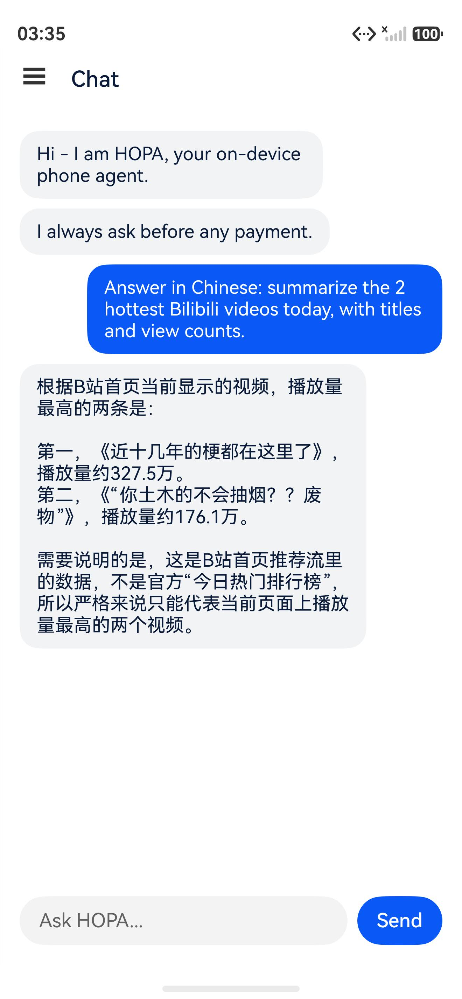
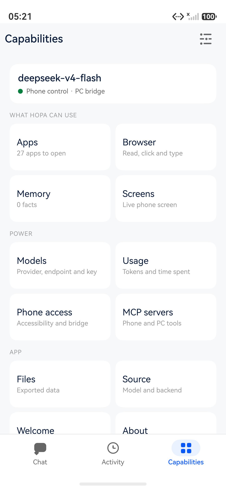
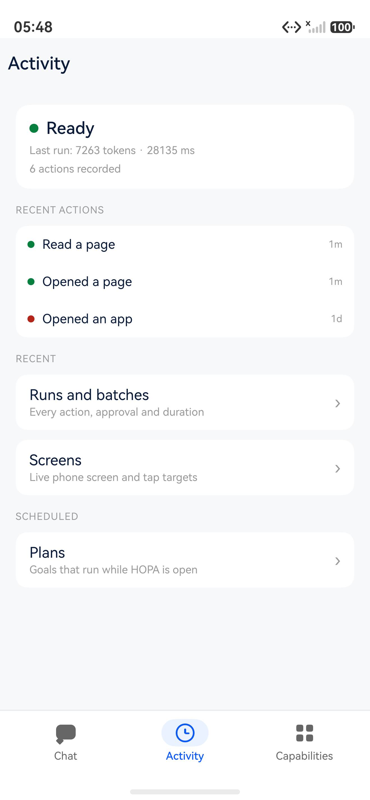
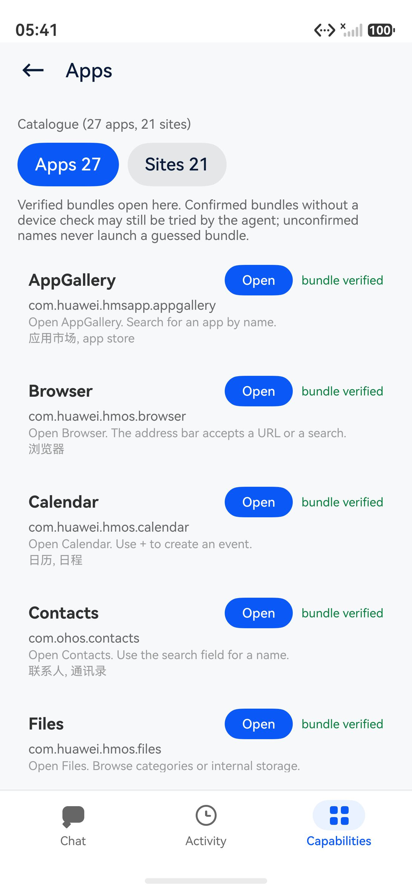
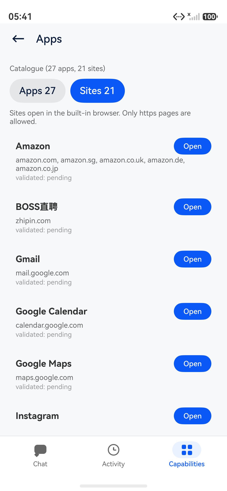

<div align="center">


<br/><br/>

[](docs/history/status-2026-11-07.md)
[](LICENSE)
[](docs/guides/setup.md)

</div>

# HOPA

**You have better things to do than tap through menus.**

HOPA is a phone assistant for HarmonyOS. You say what you want in your own
words. It opens the app or the website, reads the screen, taps, types and
scrolls — then tells you what happened.

Before money moves, it stops and asks. Every time.

HOPA has three places: **Chat** to ask, **Activity** to see what it did, and
**Capabilities** to see and set up what it can use.

> **Today:** a working prototype. Chat, the browser and website tasks are real.
> On this emulator, app control uses a small PC companion; a real phone with the
> accessibility service does not need it.
> [The honest details →](docs/history/status-2026-11-07.md)

## See it work

> **You:** “Answer in Chinese: summarize the 2 hottest Bilibili videos today,
> with titles and view counts.”
>
> **HOPA:** opens Bilibili, reads the page and answers in Chinese with the two
> hottest videos. If it needs to post, send or pay, it asks first.

<table>
<tr>
<td width="33%" align="center" valign="top">



<br/><sub><b>Real: the answer.</b> Asked for the hottest Bilibili videos, HOPA opened the page, read it, and answered in Chinese with titles and view counts.</sub>

</td>
<td width="33%" align="center" valign="top">



<br/><sub><b>Real: what it can use.</b> The model, the working phone control path, and the apps, browser, memory and screen tools on one screen.</sub>

</td>
<td width="33%" align="center" valign="top">



<br/><sub><b>Real: what it did.</b> Recent actions with their status, the full run history behind them, and scheduled plans.</sub>

</td>
</tr>
</table>

All three are real screenshots from the emulator.

When HOPA reads a page, the chat keeps a link to that page; **Open** takes you
back to it without retyping the address.

## What you can ask

| Apps | The web |
|---|---|
| “Send Alice ‘running 10 minutes late’ on WeChat.”<br/>“Check my messages on Feishu.”<br/>“Find a charger on Xianyu.” | “What are the top stories on Zhihu?”<br/>“What’s trending on Xiaohongshu?”<br/>“Summarize the top videos on Bilibili.” |

<sub>Site examples run in the browser HOPA opens for you. App examples need
that app installed; HOPA says when a bundle is missing instead of guessing.</sub>

It also remembers facts and skills you choose to keep.

**When money is involved**

> “Order the cheapest one in my cart.”
>
> HOPA shows the item, the total and the seller. You choose **Deny** or
> **Allow**. Nothing is paid without you.

## What it can reach

<table>
<tr>
<td width="50%" align="center" valign="top">



<br/><sub><b>Real: the app catalogue.</b> 27 apps and 21 sites. Green rows are bundles verified on a device; where a HarmonyOS bundle is missing, HOPA says so instead of guessing.</sub>

</td>
<td width="50%" align="center" valign="top">



<br/><sub><b>Real: the site catalogue.</b> Amazon, BOSS, Gmail, Uber and more open in the browser HOPA opens for you.</sub>

</td>
</tr>
</table>

## Why it feels different

- **You talk normally.** No commands, no scripts. “What’s hot on Bilibili?”
  “Send Alice a message.” “Find a charger under $30.”
- **It uses your apps, not a new ecosystem.** It reads the screen and works the
  app or site you already have.
- **It shows its work.** Every action lands in **Activity**, with the full run
  detail behind it.
- **It stops for money.** Every payment waits for your yes — every time, in
  every mode.
- **Your key, your data.** There is no HOPA account and no hosted backend. Your
  model key goes to the model you choose.

It also remembers what you tell it and can turn a successful run into a skill,
both editable in the app.

## Get started

**1. Put HOPA on your phone.**
Today the app is built and signed from source. The two commands live in the
[developer corner](#for-developers). On a real phone, start with
[Install on a phone](docs/guides/install-phone.md) — HarmonyOS installs HAPs
through AppGallery or `hdc`, not by tapping a download. A prebuilt package is
on the [0.1.0 release](https://github.com/michaelatamuk/hopa/releases/tag/v0.1.0).

**2. Connect a model.**
Open **Capabilities** and tap the gear, then pick a provider (OpenAI-compatible,
Anthropic, Gemini or DeepSeek), enter the endpoint, the model name and your key.
The key stays in memory; it is not saved to preferences.

**3. Give it hands.**
On a real phone, enable the built-in screen control. On this emulator, start
the small PC companion and connect it in the gear → **Settings → PC bridge**.

Why a companion? On a real phone, the system has a built-in way to let an
assistant see and tap. This emulator does not have that switch. The companion
is a small program on your computer that lends HOPA its hands. It runs on your
machine, not in the cloud.

Then say: “What’s trending on Bilibili today?”

## Good to know

- HOPA sees the screen you see. It cannot work in the background.
- It will not guess an app it does not know. Fifteen catalogue apps have no
  HarmonyOS bundle yet, and five more have an unverified one.
- Login, CAPTCHA and verification codes stay with you.
- Some apps block automation; HOPA stops and hands over.
- The PC companion is for a trusted network.
- This emulator has no accessibility switch; a real phone with it enabled is
  the untethered path.

### Where it is today

| Works | Needs a device or data |
|---|---|
| Chat, browser, memory, skills, plans, batch, runs and export | Untethered app control on this emulator |
| App control through the PC companion | Speech |
| A website task from Chat: open Bilibili, read it and summarize | System reminders |
|  | 15 apps without a bundle; 5 unverified |
|  | The retail AppGallery ACL |

Read the dated, per-capability state in
[docs/product/coverage.md](docs/product/coverage.md).

## For developers

<details>
<summary>Build it, test it, or look under the hood</summary>

<br/>

**Build and install**

```powershell
.\tools\scripts\build.ps1
.\tools\scripts\sign-app.ps1 -Install
```

```bash
./tools/scripts/build.sh
./tools/scripts/sign-app.sh --install
```

**Test**

```powershell
.\tools\scripts\run-tests.ps1
```

```bash
./tools/scripts/run-tests.sh
```

**What is where**

- `apps/harmony/` — the shippable ArkTS app (UI, agent loop, gate, router).
- `services/pc-agent/` — the PC companion: device control, CLI, MCP, bridge.
- `services/brain/` — the Kotlin reference brain for routing and knowledge.
- `harness/` — the reference loop and HOPA-Bench.
- `docs/` — setup, architecture, contracts and the honest status.

**A few useful links**

- [Setup and toolchain](docs/guides/setup.md)
- [Build, sign and install](docs/guides/build-and-sign.md)
- [PC companion guide](docs/guides/pc-bridge.md)
- [Architecture](docs/architecture/overview.md)
- [App knowledge](docs/reference/knowledge.md)
- [Bundles on a device](docs/reference/bundles.md)
- [Safety model](docs/reference/safety.md)
- [Current status](docs/history/status-2026-11-07.md)

The app is ArkTS only. Python and Kotlin are development and PC-side tools;
they are not packaged into the HAP. CI runs the Python and Kotlin suites, the
structure and link checks, the generated-catalogue check, and a secret/license
scan. The HAP and ArkTS jobs need a mirrored Huawei toolchain and are
conditional; the workflow skips them with a warning rather than pretending.

</details>

## Contributing

Read [CONTRIBUTING.md](CONTRIBUTING.md). Run the tests before a pull request.
Do not weaken the payment gate: a change that makes payment skippable, or moves
it after execution, will not be accepted. Report security issues privately
through [SECURITY.md](SECURITY.md).

## License

Apache License 2.0. See [LICENSE](LICENSE) and [NOTICE](NOTICE).
