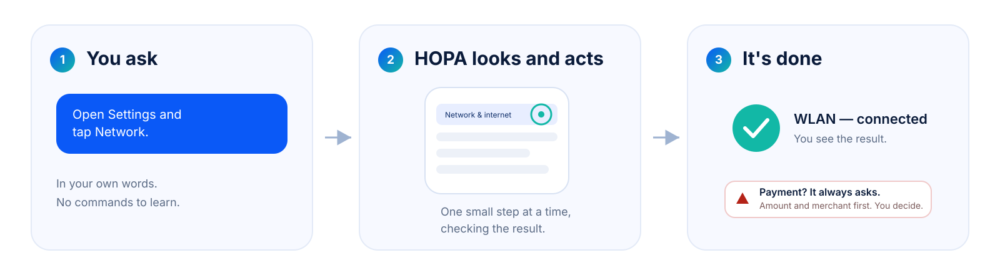
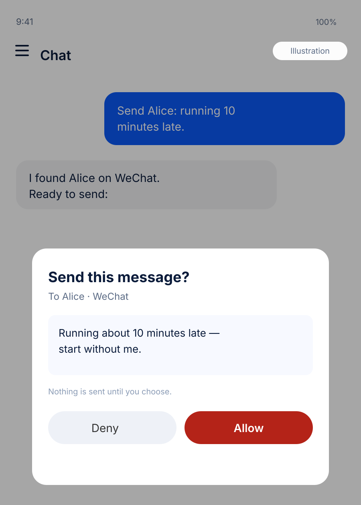

<div align="center">


<br/><br/>

[](docs/history/status-2026-11-07.md)
[](LICENSE)
[](docs/guides/setup.md)

</div>

**You have better things to do than tap through menus.**

HOPA is a phone assistant for HarmonyOS. You say what you want in your own
words. It opens the app, reads the screen, taps, types and scrolls — then tells
you what happened.

Before money moves, it stops and asks. Every time.

> **Today:** a working prototype. Chat, the browser, memory and the app-control
> loop are real. On this emulator a small PC companion lends HOPA its hands.
> [The honest details →](docs/history/status-2026-11-07.md)

## A small example

> **You:** “What are the top videos on Bilibili right now?”
>
> **HOPA:** opens Bilibili in the built-in browser, reads the page, and gives
> you the top three with links. If it needs to post, send or pay, it asks first.



## What it feels like

**You talk normally.** No commands, no scripts. “What’s hot on Bilibili?”
“Send Alice a message.” “Find a charger under $30.”

**It works in your apps.** HOPA uses the apps already on your phone, not a
separate universe. No new ecosystem to learn.

**It stops for money.** Every payment waits for your yes — every time, in every
mode.

**It remembers.** Tell it once: “I prefer aisle seats.” It keeps that, and you
can delete it whenever you like.

**It shows its work.** Every run has a history: what it did, how long it took,
and what needed your approval.

**Your key, your data.** There is no HOPA account and no hosted backend. Your
model key goes to the model you choose.

## Things you can say

| Sites and apps | The little things |
|---|---|
| “What are the top stories on Zhihu?”<br/>“What’s trending on Xiaohongshu?”<br/>“Summarize the top videos on Bilibili.” | “Send Alice ‘running 10 minutes late’ on WeChat.”<br/>“Find a 4.5-star charger under $30 on Amazon.”<br/>“Remember that I prefer aisle seats.” |

<sub>Site examples work in the built-in browser. App examples need that app
installed; HOPA says when a bundle is missing instead of guessing.</sub>

**When money is involved**

> “Order the cheapest one in my cart.”
>
> HOPA shows the item, the total and the seller. You choose **Deny** or
> **Allow**. Nothing is paid without you.

<table>
<tr>
<td width="50%" align="center" valign="top">



<sub><b>Designed example.</b> A WeChat task with the approval step. WeChat is not installed on the test emulator.</sub>

</td>
<td width="50%" align="center" valign="top">


<sub><b>Real screenshot.</b> Bilibili, Xiaohongshu, Weibo and more in the site catalogue.</sub>

</td>
</tr>
</table>

## Getting started

**1. Put HOPA on your phone.**
Today the app is built and signed from source. The two commands live in the
[developer corner](#for-developers).

**2. Connect a model.**
Open **Settings**, pick a provider (OpenAI-compatible, Anthropic, Gemini or
DeepSeek), then enter the endpoint, the model name and your key. The key stays
in memory; it is not saved to preferences.

**3. Give it hands.**
On a real phone, enable the built-in screen control. On this emulator, start
the small PC companion and connect it in **Settings → PC bridge**.

**4. Say something.**
Try “What are the top videos on Bilibili right now?”

### Why a PC companion?

On a real phone, the system has a built-in way to let an assistant see and tap.
This emulator does not have that switch. The companion is a small program on
your computer that lends HOPA its hands. It runs on your machine, not in the
cloud, and you only need it when the phone cannot do it alone.

## Good to know

- HOPA sees the screen you see. It cannot work in the background.
- It will not guess an app it does not know.
- Login, CAPTCHA and verification codes stay with you.
- Some apps block automation; HOPA stops and hands over.
- The PC companion is for a trusted network.
- 15 apps in the catalogue have no HarmonyOS bundle yet, and 5 more have an
  unverified one. HOPA says so instead of pretending.
- This emulator is not a phone: its accessibility switch is missing, the input
  service can stall, and some system features fail.

## Where it is today

A working prototype. With the PC companion, these work today:

- chat and reasoning
- the built-in browser
- memory, skills, plans and batch runs
- run history, export and self-check
- app launch, screen reading, tap, type and scroll
- the full **launch → observe → tap → observe** loop inside a real app

Not available on this emulator: untethered app control, speech and system
reminders. A real phone with the built-in control is the untethered path.
Read the dated, per-capability state in
[docs/product/coverage.md](docs/product/coverage.md).

## For developers

<details>
<summary>Build it, test it, or look under the hood</summary>

<br/>

**Build and install**

```powershell
.\tools\scripts\build.ps1
.\tools\scripts\sign-app.ps1 -Install
```

```bash
./tools/scripts/build.sh
./tools/scripts/sign-app.sh --install
```

**Test**

```powershell
.\tools\scripts\run-tests.ps1
```

```bash
./tools/scripts/run-tests.sh
```

**What is where**

- `apps/harmony/` — the shippable ArkTS app (UI, agent loop, gate, router).
- `services/pc-agent/` — the PC companion: device control, CLI, MCP, bridge.
- `services/brain/` — the Kotlin reference brain for routing and knowledge.
- `harness/` — the reference loop and HOPA-Bench.
- `docs/` — setup, architecture, contracts and the honest status.

**A few useful links**

- [Setup and toolchain](docs/guides/setup.md)
- [Build, sign and install](docs/guides/build-and-sign.md)
- [PC companion guide](docs/guides/pc-bridge.md)
- [Architecture](docs/architecture/overview.md)
- [App knowledge](docs/reference/knowledge.md)
- [Safety model](docs/reference/safety.md)
- [Current status](docs/history/status-2026-11-07.md)

The app is ArkTS only. Python and Kotlin are development and PC-side tools;
they are not packaged into the HAP. CI runs the Python and Kotlin suites, the
structure and link checks, the generated-catalogue check, and a secret/license
scan. The HAP and ArkTS jobs need a mirrored Huawei toolchain and are
conditional; the workflow skips them with a warning rather than pretending.

</details>

## Contributing

Read [CONTRIBUTING.md](CONTRIBUTING.md). Run the tests before a pull request.
Do not weaken the payment gate: a change that makes payment skippable, or moves
it after execution, will not be accepted. Report security issues privately
through [SECURITY.md](SECURITY.md).

## License

Apache License 2.0. See [LICENSE](LICENSE) and [NOTICE](NOTICE).
