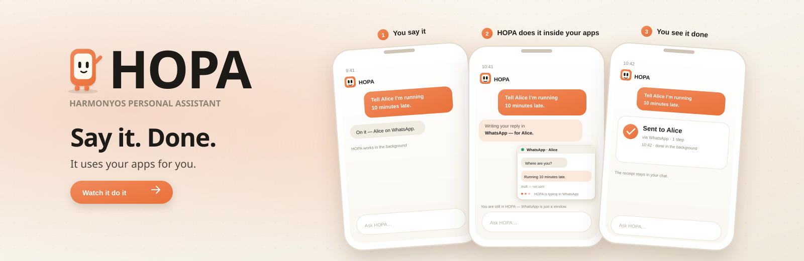
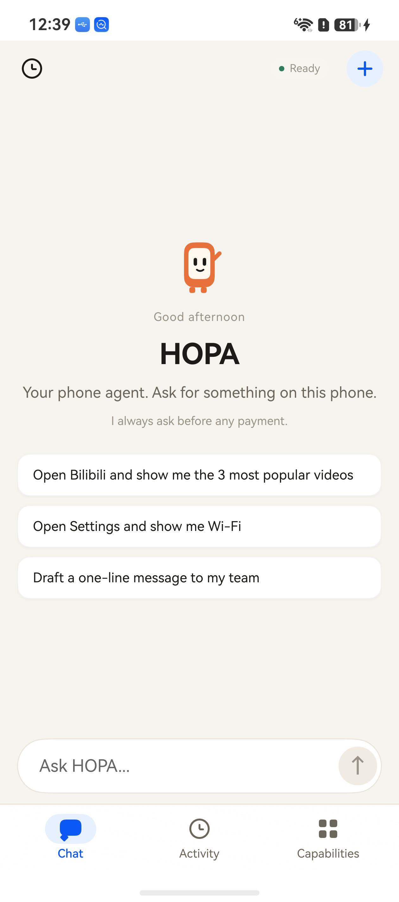
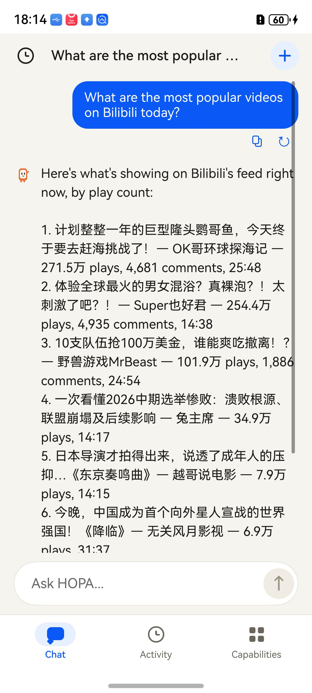
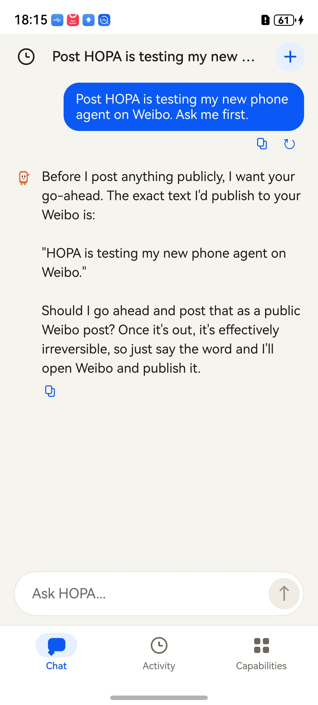
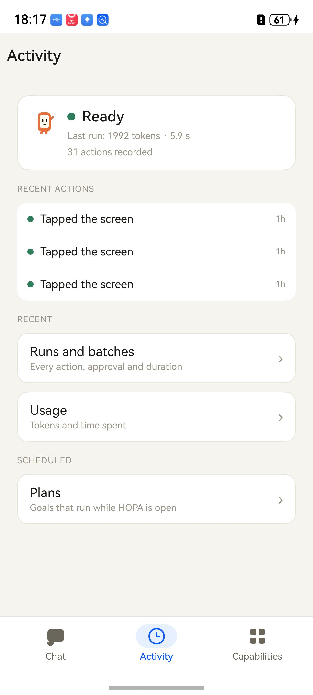
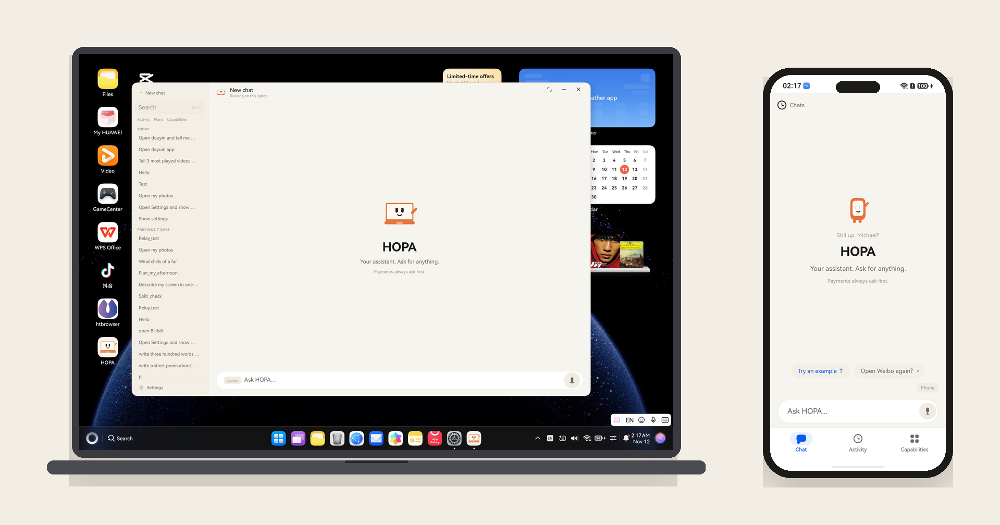
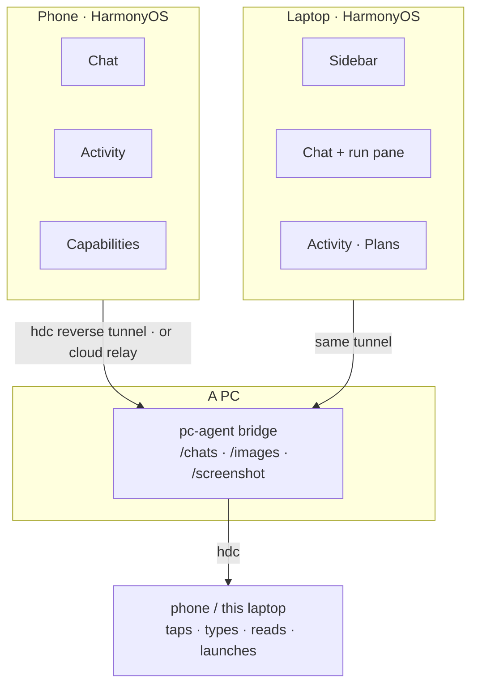
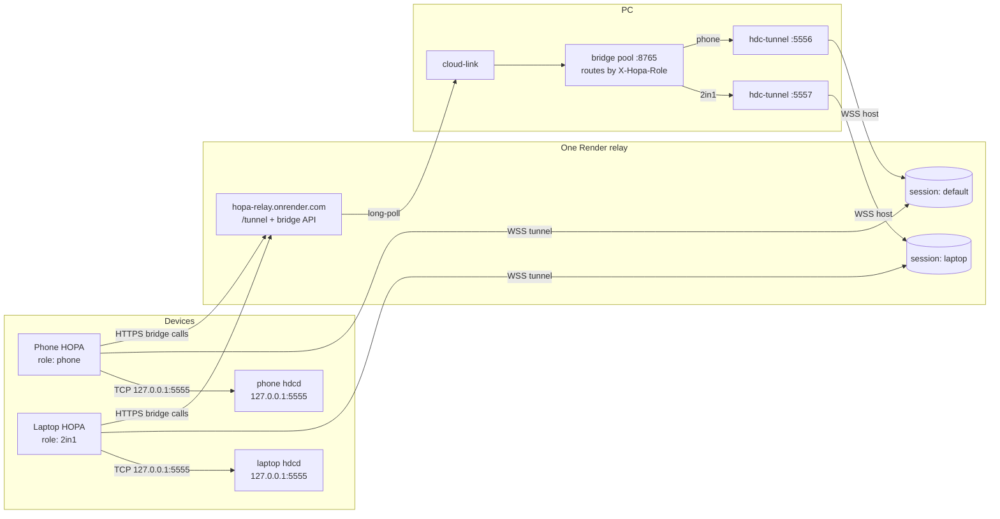

<div align="center">

<a href="docs/media/HOPA-demo-2026.mp4"></a>

<br/><br/>

[](docs/status/backlog.md)
[](LICENSE)
[](docs/guides/setup.md)
[](services/pc-agent/tests)

</div>

# HOPA

**You have better things to do than tap through menus.**

Say what you want in your own words. HOPA uses your apps for you: opens them,
taps, reads and answers. Then it tells you what happened — and it asks before
money moves.

**▶ [Watch the 62-second demo](docs/media/HOPA-demo-2026.mp4)** — HOPA saying
hello, then the real Bilibili app and a real Weibo post, end to end.

> **Working prototype on HarmonyOS 7.0.** Chat, browsing, app control through the
> PC bridge, the run pane and the payment gate are real. Next in line: local app
> control (Huawei's ACL), MCP tool calling and Chinese.
> [What comes next →](docs/status/backlog.md)

## What it looks like

<table>
<tr>
<td width="25%" align="center" valign="top">



<br/><sub><b>Home.</b> One sentence, three gentle suggestions.</sub>

</td>
<td width="25%" align="center" valign="top">



<br/><sub><b>Bilibili.</b> Read the feed, answer with play counts.</sub>

</td>
<td width="25%" align="center" valign="top">



<br/><sub><b>Weibo.</b> Draft the post, ask before publishing.</sub>

</td>
<td width="25%" align="center" valign="top">



<br/><sub><b>Activity.</b> A receipt for every action.</sub>

</td>
</tr>
</table>

## Why it is different

- **It has hands.** Not a chat that describes taps — a runtime that taps, types,
  launches and reads, then checks the screen actually changed.
- **Money always asks.** A payment is a decision with the item, the total and the
  seller in plain words — never a remembered "yes", never after the fact.

<table>
<tr>
<td width="26%" align="center" valign="middle">


</td>
<td valign="middle">

**The little phone with feet.** HOPA stands for *HarmonyOS Personal Assistant*.
It blinks while it waits, taps while it works, and hops only when something is
actually done. In Chinese, the idea is **动口不动手** — speak, don’t tap.

</td>
</tr>
</table>

## What you can ask

| On the phone | On the web |
|---|---|
| “Send Alice ‘running 10 minutes late’ on WeChat.”<br/>“Check my messages on Feishu.”<br/>“Find a charger on Xianyu.” | “What are the top stories on Zhihu?”<br/>“What’s trending on Xiaohongshu?”<br/>“Summarize the top videos on Bilibili.” |

Site examples run in the browser HOPA opens for you. App examples need that app
installed; HOPA names a missing app instead of guessing. It also remembers facts
and skills you choose to keep.

## Money is different

> “Order the cheapest one in my cart.”

HOPA shows the item, the total and the seller. You choose **Deny** or **Allow**.
Nothing is paid without you, and a payment is never remembered as a yes. The
approval is written in your language — “Confirm payment?” — never in raw action
names.

## And when your work moves to a laptop

HOPA started on the phone. It also runs on a HarmonyOS 2-in-1, and the two are
one conversation: ask in your hand, open the laptop, and the same thread is
there — with the same answer, the same steps and the same picture of what it did.

On the desk the answer gets a **run pane** beside it: `THIS RUN` with numbered
steps and durations, `WHAT HOPA SAW` — the frame it read at each step — earlier
runs in the same chat, and the cost when it was measured. A run can also choose
its machine — this phone or this laptop — so “open Settings” can act on either,
and the result still lands in the same conversation.

<table>
<tr>
<td width="55%" align="center" valign="top">

<b>The two devices, one conversation</b>

<a href="docs/media/duo-laptop-phone.mp4"></a>

<sub><b>? 20 seconds:</b> asked on the laptop, run on the phone, answered in the
same chat - and the phone goes back to where it was. <i>Click the picture to play
it.</i></sub>

</td>
<td valign="middle">

**What it keeps honest**

- Every number is measured; a failed step is named.
- The bridge line says whether the machine is reachable.
- If the run shown is older than the answer, the title says `LAST RUN` and names
  the question it belonged to.

</td>
</tr>
</table>

## Five modes, one behaviour

| Mode | Reading | Where it runs |
|---|---|---|
| **Everyday** | 13.5 pt | rail/metrics where there is room |
| **Easy** | 15 pt | fewer controls; no rail |
| **Power** | 13 pt | metrics, schedules |
| **Social** | 13 pt | no rail, no metrics |
| **Kid** | 16 pt | no history, parent PIN to leave |

The presentation adapts to the screen; the rules do not. Kid blocks payments and
public posts on the phone, and gates the desk behind a parent PIN.

## How it fits together



The bridge is the only part that touches a device, and the only part that keeps
state. It lives on a PC — usually the laptop, but it is a separate process, not a
feature of one app.

- **One store.** `GET/POST /chats` merges by content (`role:at:text`), with
  tombstones for deletes, so either app can start or finish a thread.
- **One image store.** Frames are content-addressed on the PC (`/images`), so a
  screenshot taken on the phone is shown on the desk. A path inside one device's
  sandbox would mean nothing on the other.
- **One bridge.** A pooled listener serves every device, routes by
  `X-Hopa-Role` or `/d/<serial>/…`, and authorises each caller once.
- **No cloud account.** For a phone away from the cable, `pc-agent relay` on a
  public host plus `pc-agent cloud-link` on the PC keeps the same store and
  tokens where they belong.

## Get started

**1. Build the app.**

```powershell
.\tools\scripts\build.ps1
.\tools\scripts\deploy.ps1
```

`deploy.ps1` installs the right HAP per device, restores the reverse tunnel and
starts the bridge. There are two HAPs, one per device, from one codebase.
Installing on a retail phone is its own guide:
[Install on a phone](docs/guides/install-phone.md).

**2. Connect a model.** Open **Capabilities → Settings**, pick a provider
(OpenAI-compatible, Anthropic, Gemini or DeepSeek), enter endpoint, model and
key. A loaded key stays loaded; leave the field blank to keep it.

**3. Give it hands.** Enable the accessibility service where Huawei allows it.
On the current test phones the ACL is pending, so app control goes through the
PC bridge: start it with `tools\scripts\bridges.ps1`, then connect in
**Settings → Bridge** — or tap **Use the HOPA cloud relay** to fill the relay
address in one tap.

**4. Ask.**

> “What’s trending on Bilibili today?” · “Open Settings and show me Wi-Fi.” ·
> “Draft a one-line message to my team.”

## Good to know

- HOPA sees the screen you see, while the app is open.
- Unknown apps are named, not guessed.
- Login, CAPTCHA and verification codes stay with you. Passwords and OTPs are
  never typed.
- Some apps block automation; HOPA stops and hands over.
- The bridge is for a trusted network, and pairing one device means it may act
  on the others in the pool.
- The mascot shows thinking, waiting, success and failure — and celebrates only
  when an action actually completed.

### Where it is today

| Works | Partial | Next |
|---|---|---|
| Chat, memory, skills, plans, batch, runs, export | Speech (phone) | MCP tool calling |
| App control through the PC bridge | On-device app control (Huawei ACL) | Chinese copy on both apps |
| Shared store, image store, relay, run-on-any-device choice | Desk mode depth (`Easy`/`Kid` are type-and-chrome today) | Taskbar jump actions |
| Run pane on the desk with steps, evidence, cost | Compact run view on the phone | Window repaint after long idle |

The dated, per-capability detail is in
[docs/product/coverage.md](docs/product/coverage.md); the remaining work with
effort is in [docs/status/backlog.md](docs/status/backlog.md).

## For developers

<details>
<summary>Build it, test it, or look under the hood</summary>

<br/>

**Build and install**

```powershell
.\tools\scripts\build.ps1      # both HAPs
.\tools\scripts\deploy.ps1     # install per device, tunnels, bridge
.\tools\scripts\bridges.ps1    # the bridge alone (start/stop/status)
```

**Test**

```powershell
.\tools\scripts\run-tests.ps1
```

The bridge suite alone: `pytest services/pc-agent` — **121 tests** today,
including the pooled bridge, the shared store, the image store and the relay.
CI also runs ruff, the structure and link checks, the generated-catalogue check
and a secret/license scan.

**What is where**

- `apps/harmony/app/` — the shared kit: runtime, chat formatting, bridge
  client, conversation contracts.
- `apps/harmony/core/` — the core: loop, gate, executor, run records.
- `apps/harmony/phone/` — the phone app (module `entry`).
- `apps/harmony/laptop/` — the laptop app (module `laptop`).
- `services/pc-agent/` — the PC companion and bridge: device control, store,
  images, relay.
- `services/brain/` — the Kotlin reference brain for routing and knowledge.
- `evals/` — the reference loop and HOPA-Bench.
- `docs/` — setup, architecture, contracts and the status.

**Links**

- [Setup and toolchain](docs/guides/setup.md)
- [Build, sign and install](docs/guides/build-and-sign.md)
- [PC bridge, tunnels and the cloud relay](docs/guides/pc-bridge.md)
- [Architecture](docs/architecture/overview.md)
- [Safety model](docs/reference/safety.md)
- [Status and remaining work](docs/status/backlog.md)

The apps are ArkTS only. Python and Kotlin are development and PC-side tools;
they are not packaged into the HAP.

</details>

## One relay, two devices

HOPA runs both the phone shell and the laptop shell through **one** Render relay.
There is one `/tunnel` endpoint; the phone and laptop use separate tunnel
**sessions** (`default` and `laptop`). The PC runs one bridge pool on 8765 and
one `hdc-tunnel` per session (5556 for the phone, 5557 for the laptop); the pool
routes requests by `X-Hopa-Role` (`phone` or `2in1`).



| Piece | Count | Note |
|---|---|---|
| Render relay | **1** | one service, one `/tunnel` endpoint |
| Tunnel sessions | **2** | `default` = phone, `laptop` = laptop |
| PC hdc tunnels | **2** | `127.0.0.1:5556` and `127.0.0.1:5557` |
| PC bridge pools | **1** | port 8765, routes by `X-Hopa-Role` |
| Conversation stores | **1** | the pool's `/chats` is shared |

The laptop's local 8767 bridge is a fallback, not a second relay. On a fresh
laptop, `hdc tmode port 5555` opens the device-side hdcd TCP port (it reboots
the laptop once); after that the laptop app's tunnel can reach
`127.0.0.1:5555` and the PC needs no USB.

`.\tools\scripts\run-agent.ps1` starts the pool, cloud link and both hdc
tunnels. `.\tools\scripts\run-laptop.ps1` launches the laptop in cloud mode
(`HOPA_LAPTOP_CLOUD=1`); `-Local` keeps the 8767 fallback.

## Contributing

Read [CONTRIBUTING.md](CONTRIBUTING.md). Run the tests before a pull request.
Do not weaken the payment gate: a change that makes payment skippable, or moves
it after execution, will not be accepted. Report security issues privately
through [SECURITY.md](SECURITY.md).

## License

Apache License 2.0. See [LICENSE](LICENSE) and [NOTICE](NOTICE).
