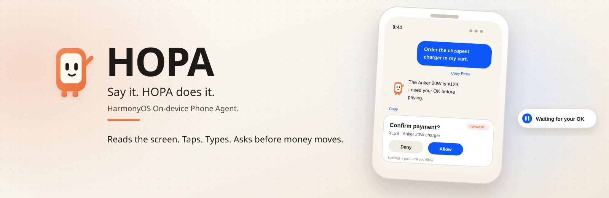
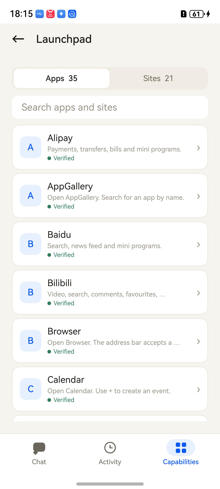
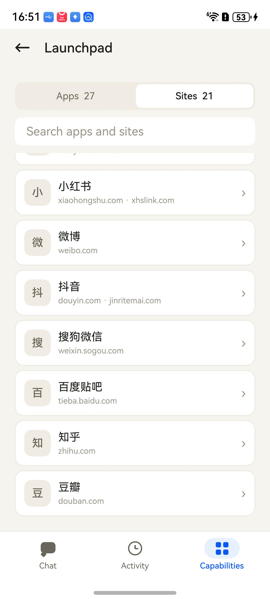
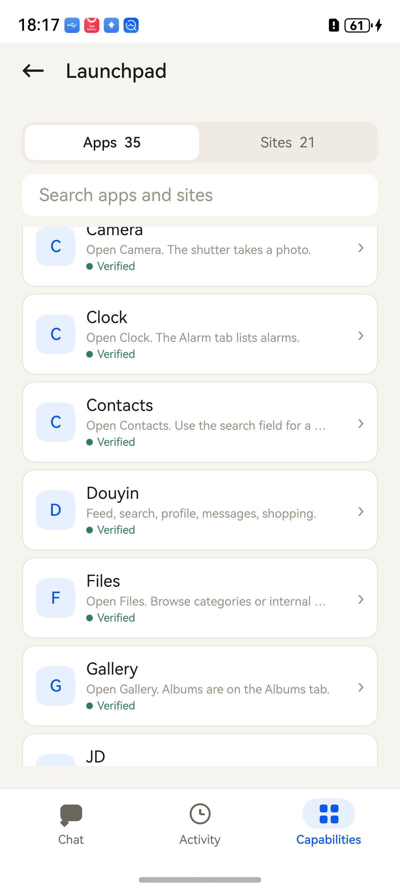
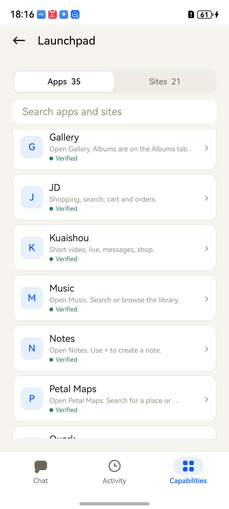
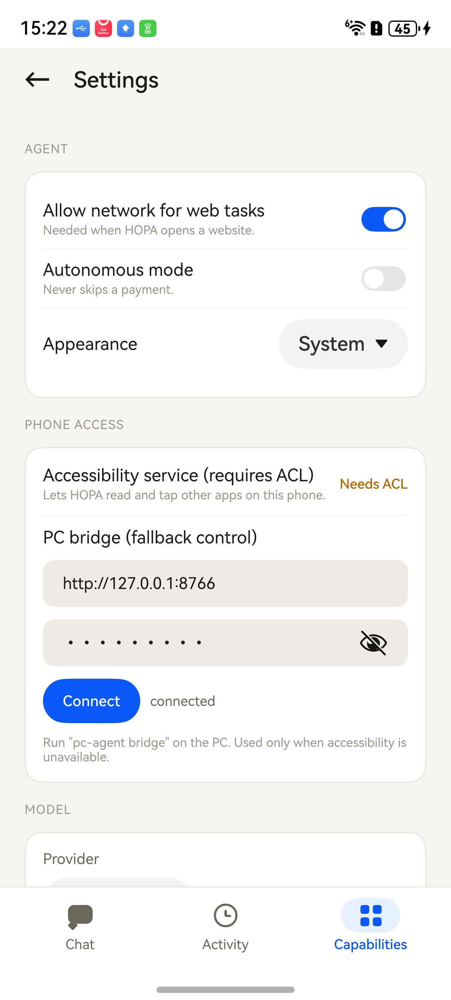
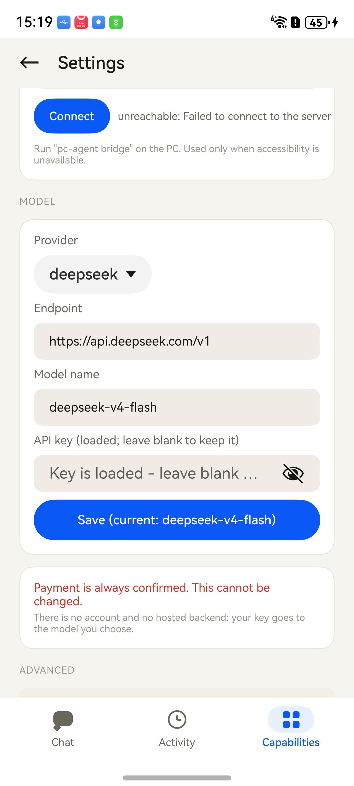
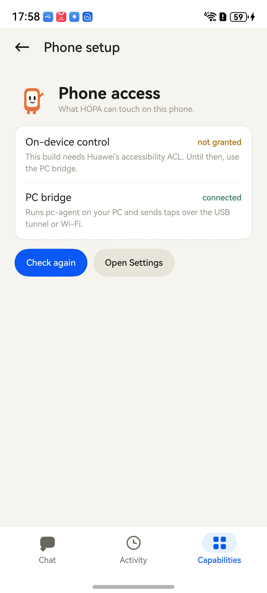

<div align="center">



<br/><br/>

[](docs/history/status-2026-11-07.md)
[](LICENSE)
[](docs/guides/setup.md)

</div>

# HOPA

**You have better things to do than tap through menus.**

<sub>HOPA — the HarmonyOS On-device Phone Agent.</sub>

HOPA is a phone agent for HarmonyOS. Say what you want in your own words. It
opens the app or the website, reads the screen, taps, types and scrolls — then
tells you what happened.

Before money moves, it stops and asks. Every time.

HOPA has three places: **Chat** to ask, **Activity** to see what it did, and
**Capabilities** to see what it can use.

> **Today:** a working prototype on a Huawei Mate 80. Chat, the browser, app
> control through the PC companion and the payment gate are real. Fully
> on-device app control waits for Huawei's accessibility ACL.
> [The honest details →](docs/history/status-2026-11-07.md)

## Meet HOPA

<table>
<tr>
<td width="30%" align="center" valign="middle">


</td>
<td valign="middle">

**The little phone with feet.**

**HOPA** stands for **HarmonyOS On-device Phone Agent**.

It blinks while it waits. It taps while it works. It hops when something
actually gets done. HOPA is not a chatbot in a box; it is the part of the phone
that does the tapping — and it stays out of the way when there is nothing to do.

In Chinese, the idea is simple: **动口不动手** — speak, don’t tap.

</td>
</tr>
</table>

## A first look

<table>
<tr>
<td width="33%" align="center" valign="top">


<br/><sub><b>Home.</b> One sentence, three gentle suggestions, and a mascot that smiles back.</sub>

</td>
<td width="33%" align="center" valign="top">


<br/><sub><b>Bilibili.</b> HOPA reads the feed and answers with the most popular videos, play counts and comments.</sub>

</td>
<td width="33%" align="center" valign="top">


<br/><sub><b>Weibo.</b> HOPA drafts the post and asks before publishing. Nothing public happens without your yes.</sub>

</td>
</tr>
</table>

## What you can ask

| Apps | The web |
|---|---|
| “Send Alice ‘running 10 minutes late’ on WeChat.”<br/>“Check my messages on Feishu.”<br/>“Find a charger on Xianyu.” | “What are the top stories on Zhihu?”<br/>“What’s trending on Xiaohongshu?”<br/>“Summarize the top videos on Bilibili.” |

<sub>Site examples run in the browser HOPA opens for you. App examples need that
app installed; HOPA says when a bundle is missing instead of guessing.</sub>

It also remembers facts and skills you choose to keep.

## Money is different

> “Order the cheapest one in my cart.”

HOPA shows the item, the total and the seller. You choose **Deny** or **Allow**.
Nothing is paid without you, and a payment is never remembered as a yes.

The approval is written in your language — “Confirm payment?” — never in raw
action names.

## Launchpad: apps and sites

<table>
<tr>
<td width="50%" align="center" valign="top">



<br/><sub><b>Launchpad.</b> 35 apps, 26 verified on the test phone. Alipay, Baidu and Bilibili are now openable.</sub>

</td>
<td width="50%" align="center" valign="top">



<br/><sub><b>Chinese sites.</b> 小红书, 微博, 抖音, 知乎, 豆瓣 and more open in the browser HOPA controls.</sub>

</td>
</tr>
<tr>
<td width="50%" align="center" valign="top">



<br/><sub><b>Chinese apps.</b> Camera, Clock and Douyin are real, verified entries now.</sub>

</td>
<td width="50%" align="center" valign="top">



<br/><sub><b>More Chinese apps.</b> JD, Kuaishou, Music, Notes and Petal Maps are verified too.</sub>

</td>
</tr>
</table>

## What it did

<table>
<tr>
<td width="50%" align="center" valign="top">


</td>
<td valign="middle">

**A receipt for every action.**

**Activity** shows what HOPA just did, the full run behind it, and what is
scheduled next. Payment decisions are listed as decisions, not hidden in a log.
The mascot sits at the top and tells you whether HOPA is ready or still working.

</td>
</tr>
</table>

## Settings that tell the truth

<table>
<tr>
<td width="33%" align="center" valign="top">



<br/><sub><b>Settings.</b> The model, the phone access path and the bridge state, all in one place.</sub>

</td>
<td width="33%" align="center" valign="top">



<br/><sub><b>Model.</b> A loaded key is hidden. The field stays blank; leave it blank to keep the key.</sub>

</td>
<td width="33%" align="center" valign="top">



<br/><sub><b>Phone access.</b> On-device control says “not granted” instead of pretending. The bridge shows its real state.</sub>

</td>
</tr>
</table>

A loaded model key is **hidden on purpose**. The field is blank, the label says
the key is loaded, and leaving it blank keeps it. Enter a new key only when you
want to replace it.

Usage is stored across restarts: actions, decisions, tokens and time. It shows a
friendly empty state until there is something real to report, instead of a wall
of zeroes.

## Get started

**1. Put HOPA on your phone.**

Today the app is built and signed from source. On a retail Huawei phone, start
with [Install on a phone](docs/guides/install-phone.md) — HarmonyOS installs HAPs
through AppGallery or `hdc`, not by tapping a download.

<sub>The prebuilt [0.1.0 release](https://github.com/michaelatamuk/hopa/releases/tag/v0.1.0)
is signed for the emulator, not for a retail phone. Rebuild and sign with your
Huawei profile to install it on a Mate 80.</sub>

**2. Connect a model.**

Open **Capabilities → Settings**, pick a provider (OpenAI-compatible, Anthropic,
Gemini or DeepSeek), enter the endpoint, the model name and your key. If a key
is already loaded, leave the field blank to keep it.

**3. Give it hands.**

On a phone that allows it, enable the accessibility service. On the current test
phone Huawei's ACL is still pending, so app control uses the small PC companion:
start `pc-agent bridge`, forward the port, then connect it in **Settings → PC
bridge**. The companion lends HOPA its hands from your computer; it runs on your
machine, not in the cloud.

**4. Ask.**

> “What’s trending on Bilibili today?”
>
> “Open Settings and show me Wi-Fi.”
>
> “Draft a one-line message to my team.”

## Good to know

- HOPA sees the screen you see. It cannot work while it is fully closed.
- It will not guess an app it does not know. 9 of the 35 catalogue apps do not
  have a verified HarmonyOS bundle yet.
- Login, CAPTCHA and verification codes stay with you.
- Some apps block automation; HOPA stops and hands over.
- The PC companion is for a trusted network.
- The little mascot is not decoration: it shows thinking, waiting, success and
  failure, and it celebrates only when an action actually completed.

### Where it is today

| Works | Needs a device or data |
|---|---|
| Chat, browser, memory, skills, plans, batch, runs and export | Untethered app control until Huawei grants the ACL |
| App control through the PC companion | Speech |
| A website task from Chat: open Bilibili, read it and summarize | System reminders |
| Payment approval with a plain-language sheet | Verified bundles for 9 other apps |
| Usage that survives a restart | |

Read the dated, per-capability state in
[docs/product/coverage.md](docs/product/coverage.md).

## For developers

<details>
<summary>Build it, test it, or look under the hood</summary>

<br/>

**Build and install**

```powershell
.\tools\scripts\build.ps1
.\tools\scripts\sign-app.ps1 -Install
```

```bash
./tools/scripts/build.sh
./tools/scripts/sign-app.sh --install
```

**Test**

```powershell
.\tools\scripts\run-tests.ps1
```

```bash
./tools/scripts/run-tests.sh
```

**What is where**

- `apps/harmony/` — the shippable ArkTS app (UI, agent loop, gate, router).
- `services/pc-agent/` — the PC companion: device control, CLI, MCP, bridge.
- `services/brain/` — the Kotlin reference brain for routing and knowledge.
- `harness/` — the reference loop and HOPA-Bench.
- `docs/` — setup, architecture, contracts and the honest status.

**A few useful links**

- [Setup and toolchain](docs/guides/setup.md)
- [Build, sign and install](docs/guides/build-and-sign.md)
- [PC companion guide](docs/guides/pc-bridge.md)
- [Architecture](docs/architecture/overview.md)
- [App knowledge](docs/reference/knowledge.md)
- [Bundles on a device](docs/reference/bundles.md)
- [Safety model](docs/reference/safety.md)
- [Current status](docs/history/status-2026-11-07.md)

The app is ArkTS only. Python and Kotlin are development and PC-side tools;
they are not packaged into the HAP. CI runs the Python and Kotlin suites, the
structure and link checks, the generated-catalogue check, and a secret/license
scan. The HAP and ArkTS jobs need a mirrored Huawei toolchain and are
conditional; the workflow skips them with a warning rather than pretending.

</details>

## Contributing

Read [CONTRIBUTING.md](CONTRIBUTING.md). Run the tests before a pull request.
Do not weaken the payment gate: a change that makes payment skippable, or moves
it after execution, will not be accepted. Report security issues privately
through [SECURITY.md](SECURITY.md).

## License

Apache License 2.0. See [LICENSE](LICENSE) and [NOTICE](NOTICE).
