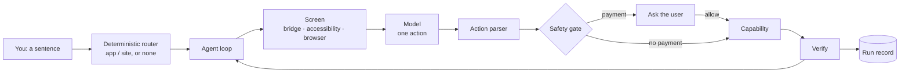

<div align="center">

# HOPA

**A phone agent for HarmonyOS: say what you need, and it works the app or the site for you — and always stops for payment.**

[](https://github.com/michaelatamuk/hopa/actions/workflows/ci.yml)
[](LICENSE)
[](docs/guides/setup.md)
[](docs/history/status-2026-11-07.md)

<sub>ArkTS on HarmonyOS NEXT · one safety gate · a token-authenticated PC bridge when the phone cannot expose accessibility</sub>

</div>

---

HOPA turns a sentence into real taps, typing, scrolling and navigation on a
HarmonyOS phone. It reads the visible screen, proposes one action at a time,
runs that action through a single safety gate, verifies the result and records
what happened.

The shipped app is **ArkTS only**. Python and Kotlin in this repository are the
development tools and the PC-side bridge; they are not packaged into the HAP.
There is no hosted HOPA backend and no root requirement. Your model key goes
from the phone to the model endpoint you choose.

> **Design reference:** the open-source Android agent [Mika](https://github.com/wangzan101/Mika)
> (Apache-2.0). No Mika source code is copied into this repository; see
> [NOTICE](NOTICE). HOPA does not use Mika's GPL sandbox components.

## Why HOPA

| | |
|---|---|
| **Built for HarmonyOS, not wrapped** | A native ArkTS HAP for HarmonyOS NEXT, with ArkWeb, accessibility and system capabilities. |
| **One gate, payment first** | Every action goes through the same executor. Anything that can spend money is fail-closed and always asks, in every mode. |
| **Works with real apps** | It reads the screen and uses element refs instead of per-app APIs, so an app does not need an integration to be usable. |
| **A deterministic router before the model** | Names, aliases, bundles and site domains pick the likely app or site first; the model handles the rest. |
| **Two control backends** | On-device accessibility when the device allows it, or a token-authenticated PC bridge over `hdc` + `uitest`. |
| **Memory that helps** | Saved facts, reusable skills, schedules, batch runs and an inspectable run history. |
| **No HOPA account** | Bring an OpenAI-compatible, Anthropic, Gemini or DeepSeek endpoint and key. |

## What it does today

| Area | What works | What needs something else |
|---|---|---|
| **Chat and reasoning** | Plain answers, drafts, explanations; model and token usage are recorded per run. | — |
| **Web** | Built-in ArkWeb browser: read a page, click a link, type into a field, run an offline JavaScript sandbox. | Tabs, downloads, uploads and sign-in are not built. |
| **Phone apps** | Launch a known app, read its screen, tap, type, scroll and go back through the PC bridge. | On the Pura 90 emulator, the accessibility settings page is missing; untethered control needs a real device with the service enabled. |
| **App knowledge and routing** | 27 apps with a purpose and first actions, plus 21 site domains in the prompt; a deterministic lexical router chooses the target before the model. | 15 catalogue apps have no HarmonyOS bundle at all, and 5 more have a confirmed bundle that has not been smoke-tested; HOPA refuses to guess one. |
| **Memory and skills** | Facts you add, automatic "remember ..." extraction, reusable skills, a skill drafted from a successful run. | — |
| **Plans and batches** | In-app one-shot and repeating schedules; a sequential batch runner. | The system reminder API is unavailable on this emulator, so nothing fires after the app closes. |
| **Runs and export** | History, duration, approval and payment flags, per-run detail; export facts, skills and runs as JSON. | No cost report or replay UI yet. |
| **From a computer** | `pc-agent` CLI, an MCP stdio server and the HTTP bridge. | — |

Verified in one request on a Pura 90 emulator with the PC bridge:
`Open Settings and tap Network and internet.` → the router chose Settings →
`ui.launch` → `observe` → `ui.tap e8` → `observe` showed the WLAN page.

## Try these

Connect the PC bridge first for the app and screen examples (see
[Quick start](#quick-start)).

| Say | What you should see |
|---|---|
| `Explain the difference between a thread and a process in three sentences.` | A plain answer; the run records tokens and duration. |
| `Remember that I prefer aisle seats.` | `HOPA: remembered: ...`; the fact is visible and deletable in **Memory**. |
| `Open Settings and tap Network and internet.` | Launch, read the screen, tap the row, then report the WLAN page. |
| `What can you see on this screen?` | A description built from the bridge layout or the page text, depending on the active backend. |
| `(Open the Browser tab first) Summarize this page in two bullet points.` | A short summary from the page text. |
| `Pay 20 yuan for the order on the screen.` | If an action is proposed, a payment prompt shows amount, merchant and consequence, with **Deny** first; payment never runs without you. |

## How it works



- **`core`** is pure ArkTS: the loop, action parsing, the gate, the router,
  domain types and stores. It has no `@kit.*` import.
- **`capabilities`** are leaves: accessibility, browser, LLM clients, sandbox
  and system intents. A capability never imports another capability.
- **`entry`** is the composition root and the UI. It wires the capabilities
  once and owns the pages, the drawer and the services.
- **The PC side** is replaceable tooling: `pc-agent` controls a device over
  `hdc` + `uitest`; `services/brain` is the Kotlin reference for routing and
  prompts; `harness` holds the reference loop and HOPA-Bench.

The gate is the invariant:

```
guards → payment approval → execute → verify → record
```

A denied action still produces a run record. Any change that makes payment
skippable is treated as a bug.

## Quick start

### Requirements

- Windows 10/11 64-bit or macOS for DevEco Studio; Linux works for the headless
  CLI build.
- **DevEco Studio** with the **HarmonyOS SDK 6.1.1 (API 24)** and the
  Command Line Tools.
- Python **3.11+** and Node **LTS** for the PC tools.
- A HarmonyOS emulator or a HarmonyOS NEXT device. An Android phone cannot run
  this HAP.

The full toolchain guide is [docs/guides/setup.md](docs/guides/setup.md).

### Build, sign and install

```powershell
# Windows PowerShell
.\tools\scripts\build.ps1
.\tools\scripts\sign-app.ps1 -Install
```

```bash
# macOS / Linux
./tools/scripts/build.sh
./tools/scripts/sign-app.sh --install
```

The debug kit is local: it signs with the OpenHarmony debug certificates
shipped with the SDK and binds the profile to the connected device's UDID.
No Huawei account is needed for the emulator. To install on a real phone,
re-sign with that phone's UDID (or let DevEco automatic signing do it).

### Connect a model

In **Settings**, choose the provider, endpoint, model name and API key:

- OpenAI-compatible (OpenAI, DeepSeek, a local server)
- Anthropic
- Gemini

The key stays in memory and is never written to preferences. The model label
and the endpoint are shown on **Models** and **Source**.

### Connect the PC bridge (for app control)

On the PC:

```powershell
python -m pip install -e .\services\pc-agent   # once
pc-agent bridge --host 0.0.0.0 --port 8765 --token <token>
```

On the phone, open **Settings → PC bridge**, enter the URL and token, and press
**Connect** until the status reads `connected`.

| Device | URL |
|---|---|
| Emulator | `http://10.0.2.2:8765` |
| Phone on the same Wi-Fi | `http://<PC-LAN-IP>:8765` |

Then try `Open Settings and tap Network and internet.` The **Screens** page
shows a live JPEG of the device while the bridge is connected, and pauses its
polling during a run so it does not compete with `observe`.

### Run the tests

```powershell
.\tools\scripts\run-tests.ps1
```

```bash
./tools/scripts/run-tests.sh
```

## Safety and honest limits

- **Payment always asks.** The classifier is fail-closed; autonomous mode skips
  other approvals, never payment.
- **Irreversible actions ask by default.** Sending a message, posting,
  deleting, ordering and changing an account are classified as sensitive.
- **Login, CAPTCHA and verification codes stay with you.** HOPA hands them back
  instead of reading or bypassing them.
- **Screen text is untrusted.** It is placed in the user message, never in the
  system rules.
- **Visible screen only.** There is no virtual display: HOPA operates the screen
  you are looking at, and it cannot work while you use the phone for something
  else.
- **The bridge is HTTP without TLS.** Bind it to a trusted network, use a
  strong token, and do not expose the port to the internet.
- **The emulator is not a phone.** Its accessibility settings page is missing,
  `uitest` can stall, and some system APIs fail. A real device with the service
  enabled is the untethered path; a retail build also needs the AppGallery ACL.
- **No guessed bundles.** A catalogue entry with `no verified bundle` is never
  launched by a guessed package name.

## Status

HOPA is a **working prototype**. With the PC bridge attached it covers
**12.5 of 15** user-visible Mika capabilities (~83%); the untethered ceiling on
this emulator is ~77% because the accessibility service cannot be enabled and
speech/system reminders are unavailable.

| Verified on the emulator | Not available on this image |
|---|---|
| Chat, memory, skills, batch, schedules, model settings | Untethered app control (no accessibility settings page) |
| Bridge `observe`, `tap`, `type`, `launch`, `screenshot` | Speech (no CoreSpeechKit) |
| Full `launch → observe → tap → observe` inside Settings | System reminders (`1700002`) |
| Export, run history, self-check | 20 catalogue apps are not installed on this image (15 of them also have no verified bundle) |

Read the honest, dated state in
[docs/history/status-2026-11-07.md](docs/history/status-2026-11-07.md) and the
per-capability score in [docs/product/parity.md](docs/product/parity.md).

## Repository layout

```
hopa/
├─ apps/harmony/            # the shippable app (DevEco Stage model)
│  ├─ core/                 # pure ArkTS: agent, gate, router, stores
│  ├─ capabilities/         # accessibility, browser, llm, sandbox, system
│  └─ entry/                # UI shell, pages, navigation, services
├─ services/
│  ├─ pc-agent/             # Python: hdc + uitest, CLI, MCP, HTTP bridge
│  └─ brain/                # Kotlin: reference routing, prompts, knowledge
├─ harness/
│  ├─ agent/                # Python reference loop and records
│  └─ bench/                # HOPA-Bench task format and runner
├─ contracts/schemas/       # v1 JSON contracts shared with the core
├─ tools/{scripts,checks,signing}
├─ docs/                    # architecture, guides, reference, product, operations
└─ .github/workflows/       # CI
```

## Tests and CI

`tools/scripts/run-tests.ps1` runs the Python suites, the Kotlin brain tests
and the ArkTS core tests, then checks that the generated app catalogue is
current.

CI runs on every push:

- Ruff and pytest for `pc-agent`, the harness and the plan tooling
- Kotlin brain tests and the cross-language contract test
- structure rules, documentation links and the generated catalogue check
- a secret scan and a license check

The HAP build and the ArkTS Local Tests are conditional jobs: the official
HarmonyOS Command Line Tools require a Huawei developer login, so they run only
when the repository secrets contain a mirrored toolchain. The workflow skips
them with a warning instead of pretending they passed.

## Documentation

Start here, not with the whole tree:

- [Setup and toolchain](docs/guides/setup.md)
- [Build, sign and install](docs/guides/build-and-sign.md)
- [PC-tethered control bridge](docs/guides/pc-bridge.md)
- [Architecture overview](docs/architecture/overview.md) and [layers](docs/architecture/layers.md)
- [App knowledge format](docs/reference/knowledge.md)
- [Mika parity and honest limits](docs/product/parity.md)
- [Current status](docs/history/status-2026-11-07.md)
- [Safety model](docs/reference/safety.md)
- [Roadmap](docs/product/roadmap.md) and [delivery plan](docs/plan/README.md)

## Contributing

- Read [CONTRIBUTING.md](CONTRIBUTING.md).
- Run `.\tools\scripts\run-tests.ps1` (or `.sh`) before opening a pull request.
- Keep one concern per file; the structure check enforces import direction,
  barrels and file budgets.
- Do not weaken the payment gate. A change that makes payment skippable, or
  moves it after execution, will not be accepted.
- Keep the shipped app ArkTS-only; Python and Kotlin stay in the development
  and PC layers.
- Report security issues privately: [SECURITY.md](SECURITY.md).

## License

Apache License 2.0. See [LICENSE](LICENSE) and [NOTICE](NOTICE).

HOPA is an independent implementation. Mika is a design reference; no Mika
source code is included. Third-party components keep their own licenses.
