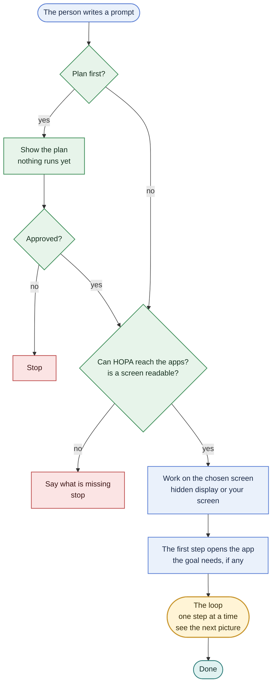
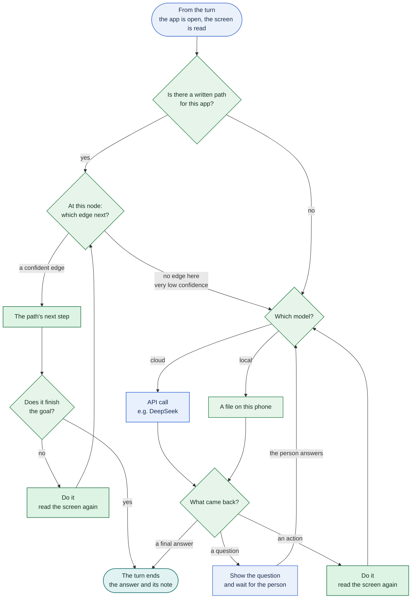

# One turn, from a prompt to an answer

This page replaces the hand-drawn
[`docs/media/hopa-turn-flow.png`](../../media/hopa-turn-flow.png). It has two
pictures: the whole turn, with the loop as one box, and the loop itself.

A few words are used throughout:

- **written path** - a few hand-written steps for an app HOPA knows (Settings,
  Clock, Camera). It remembers where it is: the current screen is a node, and the
  things it can do next are the edges from that node.
- **model** - the AI that writes the next step or the answer. It is either
  **cloud** (an API call, like DeepSeek) or **local** (a file downloaded to this
  phone).
- **token** - what a model is paid by. `0 tokens` means no model was asked.

## 1. The whole turn

The loop is a single box here; the next picture opens it.

## 2. The loop

One loop, two engines, one hand-over:

- while the current screen has a **written path**, the path decides the next
  edge at this node; if it has a confident edge, HOPA takes it and reads the
  screen again;
- if the path has **no edge** here (very low confidence), the rest of the turn
  is handed to the model;
- the model runs **in the cloud** or **on this phone**, and can answer, ask, or
  act.

## Two notes about the picture

**The decision at a node.** The picture says a decision is asked at the current
node. In today's code that decision is the written path's own matcher: it reads
the visible screen, matches the node, and looks for an edge whose words fit the
goal. The decision layers (Rules, LAIX) currently vote on the model's proposed
steps, not on graph edges. Letting a layer decide the graph edge is a code change
that has not been made; the picture shows the place where it would happen.

**Shortcuts left out on purpose.** Between the doorway and the loop there are two
fast paths that would crowd the picture:

- a **simple command** ("open", "back", "home", "scroll", "wait") is answered in
  one step, with no model;
- a **saved recipe** (steps that worked before for the same words) is replayed
  before the model is asked.

**Writing paths only.** If the person chose **Written paths only** on How HOPA
acts - Steps, there is no hand-over: an app or edge the path does not know ends
the turn with a note to switch to Auto or Model.

## What the person sees

| Where | What it says |
|---|---|
| While HOPA works | `Graph · Camera`, `Cloud · deepseek-v4-flash`, or the local model's name |
| Under the answer | `Graph · 2 steps · 2 confirmed · 0 tokens` |
| Tap the note | which screen was used, how long it took, and every step |
| Activity | the same steps, the usage and the runs, kept on the phone |

The note under the answer is saved with the message, so a written path still
looks like a written path months later. It appears only when at least one step
actually ran.

## Where this lives in the code

| Concern | Code |
|---|---|
| The doorway, the hand-over and the order | `core/agent/.../turn/TurnRunner.kt` |
| The model loop, the three outcomes | `core/agent/.../loop/AgentLoop.kt` |
| The written path: nodes, edges, the current screen | `core/decision/.../graph/` |
| Doing a step and the approval question | `core/agent/.../action/ActionExecutor.kt` |
| Cloud or local: the model choice | `core/inference/...`, `apps/android/app/.../di/AppContainer.kt` |
