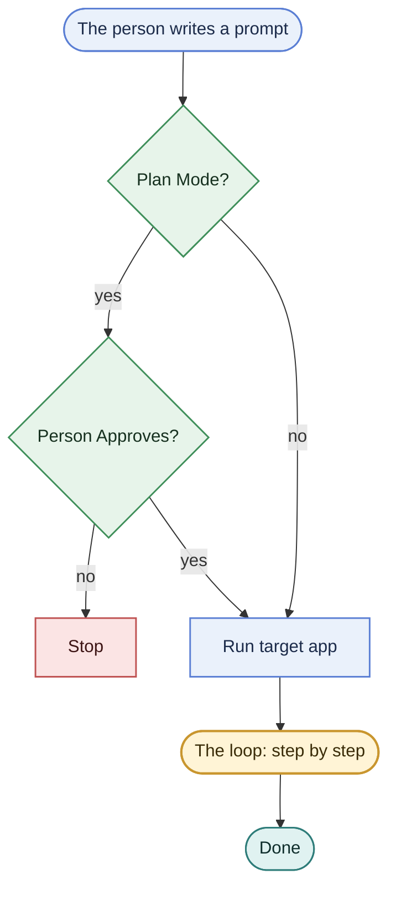
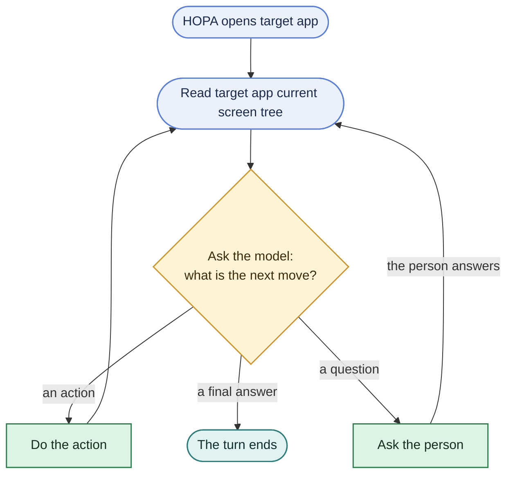
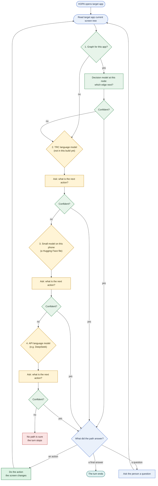

# One turn, from a prompt to an answer

This page replaces the hand-drawn
[`docs/media/hopa-turn-flow.png`](../../media/hopa-turn-flow.png). It has two
pictures: the whole turn, with the loop as one box, and the loop itself.

A few words are used throughout:

- **graph** - a few hand-written steps for an app HOPA knows (Settings,
  Clock, Camera). It remembers where it is: the current screen is a node, and the
  things it can do next are the edges from that node.
- **model** - the AI that writes the next step or the answer. It is either
  **cloud** (an API call, like DeepSeek) or **local** (a file downloaded to this
  phone).
- **token** - what a model is paid by. `0 tokens` means no model was asked.

## 1. The whole turn

The loop is a single box here; the next picture opens it.

## 2. The loop, simply

The loop is one question repeated: look at the screen, ask a model what to do,
act on the answer. Nothing here says where the model runs or which path was
tried; that is the next picture.

## 3. The loop: four paths, tried in order

Every turn starts the loop the same way: **read the screen tree**, then try the
four paths in order. Each path is asked one question - "what is the next action?"
- and returns one of three things: an action, a question, or a final answer.

| Order | Path | Asked | If it is not sure |
|---|---|---|---|
| 1 | **Graph** for this app | the decision model at the current node: which edge next? | next path |
| 2 | **TRC language model** (not in this build yet) | what is the next action? | next path |
| 3 | **Small model on this phone** (a Hugging Face file) | what is the next action? | next path |
| 4 | **API language model** (e.g. DeepSeek) | what is the next action? | the turn stops |

What comes back decides what happens next:

- **an action** - HOPA does it, the app's screen changes, and the loop starts
  again with a new screen tree;
- **a question** - shown to the person, and their answer brings the loop back to
  the start;
- **a final answer** - the turn ends. In a graph this is a leaf edge: the node
  that finishes the goal.

The graph does not ask a language model: its "confidence" is how sure it is that
one of the current node's edges fits the screen and the goal. A language model's
confidence is part of its reply. A path that is not sure enough hands the step to
the next path instead of guessing.

## Two notes about the picture

**What is in the build today.** The graph is no longer a way around the loop: it
is a step policy, so it walks one edge per pass inside the loop and answers with
the same three things a model does - an action, a question or a final answer. A
turn asks the graph first and the model second (`ChainDecisionPolicy`); the
command and the saved recipe are still turn-level shortcuts and move into the
chain next. There is no TRC path yet.

**The decision at a node.** The graph policy reads the visible screen, matches
the node by its labels and looks for an edge whose words fit the goal. The
decision layers (Rules, LAIX) now see the graph's step too, because every step
reaches them the same way, whoever proposed it.

**Shortcuts left out on purpose.** Between the doorway and the loop there are two
fast paths that would crowd the picture:

- a **simple command** ("open", "back", "home", "scroll", "wait") is answered in
  one step, with no model;
- a **saved recipe** (steps that worked before for the same words) is replayed
  before the model is asked.

**Graph only.** If the person chose **Graph** on How HOPA
acts - Steps, there is no hand-over: an app or edge the graph does not know ends
the turn with a note to switch to Auto or Model.

## What the person sees

| Where | What it says |
|---|---|
| While HOPA works | `Graph · Camera`, `Cloud · deepseek-v4-flash`, or the local model's name |
| Under the answer | `Graph · 2 steps · 2 confirmed · 0 tokens` |
| Tap the note | which screen was used, how long it took, and every step |
| Activity | the same steps, the usage and the runs, kept on the phone |

The note under the answer is saved with the message, so a graph still
looks like a graph months later. It appears only when at least one step
actually ran.

## Where this lives in the code

| Concern | Code |
|---|---|
| The doorway, the hand-over and the order | `core/agent/.../turn/TurnRunner.kt` |
| The model loop, the three outcomes | `core/agent/.../loop/AgentLoop.kt` |
| The graph: nodes, edges, the current screen | `core/decision/.../graph/` |
| Doing a step and the approval question | `core/agent/.../action/ActionExecutor.kt` |
| Cloud or local: the model choice | `core/inference/...`, `apps/android/app/.../di/AppContainer.kt` |
