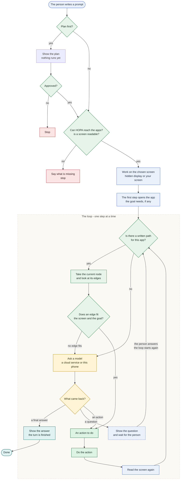

# One turn, from a prompt to an answer

This picture replaces the hand-drawn
[`docs/media/hopa-turn-flow.png`](../../media/hopa-turn-flow.png). It shows one
turn the way the code actually runs it: a short doorway first, then a loop that
picks one step at a time.

Two words are used throughout:

- **written path** - a few hand-written steps for an app HOPA knows (Settings,
  Clock, Camera). It remembers where it is: the current screen is a node, and the
  things it can do next are the edges from that node.
- **model** - the AI that writes the next step or the answer. It can be a cloud
  service or a file on this phone.
- **token** - what a model is paid by. `0 tokens` means no model was asked.

## The loop, in words

There are two engines inside the loop, and either one can produce three things.

| Engine | Where it gets the next step | If it has nothing |
|---|---|---|
| A written path for this app | the current node and its edges | the model is asked instead (in **Auto**); in **Written paths only** the turn says so and stops |
| A model | a cloud call, or a file on this phone | it says it is stuck; it never guesses |

Whatever runs, the answer is one of three:

- **a final answer** - shown to the person, and the turn ends;
- **a question** - shown, and the person's reply brings the loop back to the
  start with that answer in the conversation;
- **an action** - HOPA does it, reads the screen again, and the loop continues.

After an action the written path already knows where it is, because the new
screen is a node it recognizes. The model does not remember a path; it reads the
new screen as part of the next question to the model. That is the only
difference between the two engines from the outside.

## Two things the picture leaves out on purpose

- A written path that can finish the goal runs **before** the plan question, so
  "open camera" never shows a plan. The plan question is for goals nothing
  written can finish.
- If the person chose **Written paths only** on How HOPA acts - Steps, the model
  is never used: an app or edge the path does not know ends the turn with a note
  to switch to Auto or Model.

Two shortcuts sit between the doorway and the loop and are not drawn, so the
picture stays about steps:

- a **simple command** ("open", "back", "home", "scroll", "wait") is answered in
  one step, with no model;
- a **saved recipe** (steps that worked before for the same words) is replayed
  before the model is asked.

## What the person sees

| Where | What it says |
|---|---|
| While HOPA works | `Graph · Camera`, or the model's name when the model really runs |
| Under the answer | `Graph · 2 steps · 2 confirmed · 0 tokens` |
| Tap the note | which screen was used, how long it took, and every step |
| Activity | the same steps, the usage and the runs, kept on the phone |

The note under the answer is saved with the message, so a written path still
looks like a written path months later. It appears only when at least one step
actually ran.

## Where this lives in the code

| Concern | Code |
|---|---|
| The doorway and the order of the two engines | `core/agent/.../turn/TurnRunner.kt` |
| The loop, the model call, the three outcomes | `core/agent/.../loop/AgentLoop.kt` |
| The written path: nodes, edges, the current screen | `core/decision/.../graph/` |
| Doing an action and the approval question | `core/agent/.../action/ActionExecutor.kt` |
| The model: cloud, network, on this phone | `core/inference/...`, `apps/android/app/.../di/AppContainer.kt` |
