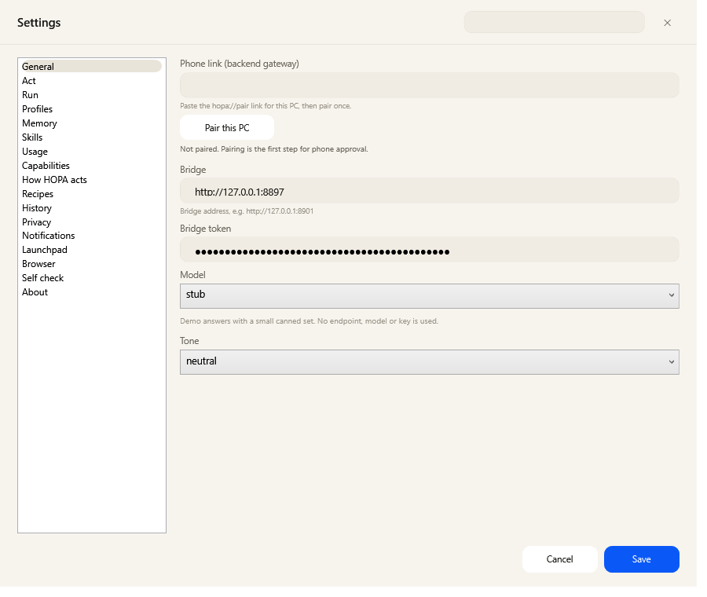

# W10 model source and step source

Status: **Demo, API/LAN and `auto`/`model` are implemented. On-device and
graph/anchors are deliberately not offered.**

## Settings

`Settings → General` (the Answers page) now has three providers:

| Provider | Behaviour |
|---|---|
| `openai` | OpenAI-compatible API, e.g. DeepSeek at `https://api.deepseek.com` |
| `lan` | OpenAI-compatible server on the local network |
| `stub` | Demo answers from `ScriptedModel`; endpoint/model/key fields are hidden |

An explicit `stub` wins over a saved key. Before this, a key always forced the
cloud path even when the provider said stub (`ProviderChoiceRules`), so a UI
item alone would not have worked.



The endpoint, model name and key fields are hidden for Demo; the hint says no
model or key is used.

`stub` is a real proposer, not an approver: the gate still classifies and
approves every action.

## Step source

`Settings → Run` has `auto`, `anchors` and `model`:

- `auto` — try a known app graph, then a recipe/instant command, then the model;
- `anchors` — graph only; no graph means the turn refuses rather than calling a
  model;
- `model` — skip graphs, recipes and instant commands.

Windows graph v1 is
`apps/windows/sidecar/src/main/resources/windows-graphs.v1.json`: Notepad, File
Explorer and Calculator. A live `--turn "open notepad"` with `steps=anchors`
produced:

```text
sidecar: configured ... steps=anchors
device: launched notepad (foreground=notepad)
step 0: ui.launch tier=uia executed=True
HOPA: Opened Notepad.
```

The catalogue is deliberately small; it is content, not a matcher rewrite.

## On-device

The Windows client runs llama.cpp's CPU server on loopback. The curated model
is Qwen3 1.7B, GGUF Q4_K_M, Apache-2.0:

| | |
|---|---|
| weights | 1,282,439,264 bytes, SHA-256 `D2387CA2…D9BC7B5` |
| runtime | llama.cpp `b12721`, SHA-256 `BEF517FB…C8003046` |
| context | 32,000, thinking off (`--reasoning-budget 0`) |
| files | `%LOCALAPPDATA%\HOPA\local` and `…\models`, never in the MSI |

The receipt keeps the choice instead of hiding it behind `lan`:

```text
sidecar: configured ... model=on-device steps=auto tone=neutral
sidecar: turn r-… vision=false
device: observed 200 nodes in 'OpenCode'
device: invoked e9
step 0: ui.tap tier=uia executed=True
HOPA: I stopped after 10 minutes.
```

That transcript is the honest result: one step reached the local model and
executed, but the next decision passed the ten-minute deadline. A 200-node
screen is the worst case. On a 49-node window the same goal completed two
steps in 256.5 s, and the whole `--turn` run took 269.7 s including server
start and model load.

So a local turn is minutes, not seconds. Before this is comfortable the chat
needs live progress and an explicit switch to the API (MODEL-16/17), and the
prompt needs a budget for a local model (MODEL-13).

`ModelNotLoaded` is now reachable only when someone configures `on-device`
without a loopback endpoint: `LocalEndpoint` parses the host and refuses
anything that is not `127.0.0.1`, `localhost` or `::1`, so the screen cannot
travel elsewhere under a local label.

The Settings page installs the runtime and the model after a licence
confirmation, imports a person's `.gguf` (magic checked), deletes a model, and
restarts the server when the file changes.

## Verification

- `HeadlessTurnTest.an_explicit_stub_provider_wins_over_a_saved_key`
- `RuntimeConfigTest.step_source_is_auto_or_model_only`
- `SettingsStoreTests` round-trip `StepSource`
- `LocalEndpointTest` accepts only loopback hosts; a lookalike domain is refused
- `ModelFactoryTest` builds `HttpLocalEngine` for a loopback endpoint and keeps
  `ModelNotLoaded` for a missing one
- `LocalModelManagerTests` import, delete, context and thinking-budget rules
- `--turn` with `stub` never calls the network; the answer starts with
  `Stub answered`.
- `--turn` with `on-device` shows `model=on-device` and executes a real UIA step
  (transcript above).
