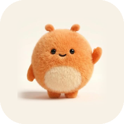

# Plush mark — Android and Windows

Date: 2026-11-18. Source artwork: a user-supplied photo, committed at
`tools/assets/hopa-plush-2026.jpg` (473 x 1024). Harmony is unchanged.

## What changed

- **Android:** the launcher icon is the plush on a `#F7F1E6` field; the adaptive
  foreground keeps the raised hand inside the 66 dp safe circle; the monochrome
  themed icon is a hand-drawn silhouette. `HopaMascot` now renders a 512 px
  rounded badge and animates it: float, breathe, blink, thinking pulse, listening
  lean, happy scale, and a tap wiggle plus the existing greeting bubble.
- **Windows:** every window and the executable carry `Assets/hopa.ico`. A new
  `Controls/HopaMark` control shows the badge in the empty state and animates it;
  the header and answer avatars use the same control with `IsStatic="True"`.
- Transcript avatars stay still on both clients, as before.

## Generator

```powershell
python tools/scripts/make-icon.py
```

It reads the committed photo and writes the Android mipmaps, the 108 dp
foreground layers, the 512 px avatar and blink frame for both clients, the
Windows ICO, and `docs/media/hopa-plush-2026.png`. The blink frame is painted
locally: forehead fur covers each eye and a closed-eye arc is drawn; every other
pixel is unchanged.

```powershell
python -m pytest tools/scripts/test_make_icon.py -q
# 4 passed
```

The tests pin the crop, the 33 dp safe radius, the blink diff being confined to
the eye boxes, and every output size including the seven ICO sizes.

## Android

```powershell
cd apps/android
.\gradlew.bat :app:assembleDebug
# BUILD SUCCESSFUL
```

Device installation was deliberately skipped: the user is testing the Android
app on another branch, so this worktree did not overwrite that install. The APK
compiles and packages the new resources; on-device screenshots remain for that
branch.

## Windows

```powershell
dotnet build apps/windows/Hopa.Windows/Hopa.Windows.csproj
# Build succeeded, 0 warnings, 0 errors

dotnet test apps/windows/Hopa.Windows.Tests/Hopa.Windows.Tests.csproj
# Passed: 8, Failed: 0
```


Two screen captures 1.2 s apart showed the empty-state badge at different
heights, confirming the float. The exe icon was extracted from the built binary:



The taskbar and Alt-Tab use the same ICO. Blink and breathing are timer and
storyboard driven; a still cannot show them, but the empty-state instance is the
only one that starts those timers.

## Reduced motion

- Android reads `Settings.Global.ANIMATOR_DURATION_SCALE` once per mascot; at 0
  it creates no idle transition and no blink loop. Transcript avatars pass
  `animate = false` and do the same.
- Windows starts the storyboard only when
  `SystemParameters.ClientAreaAnimation` is true and `IsStatic` is false.

## Deliberate divergence

Android and Windows now use the plush; Harmony still uses the coral phone and the
repo README still describes the phone. That is the agreed scope for this change.

## Left for the other branch

- On-device Android checks: app-info icon under squircle and circle masks, themed
  icon, empty-state hero, 26 dp answer avatar, 20 dp thinking avatar, tap bubble.
- A look at the blink at 76 dp and the 1.06 tap cheer in motion.
- Any timing tuning that only a device can settle.
