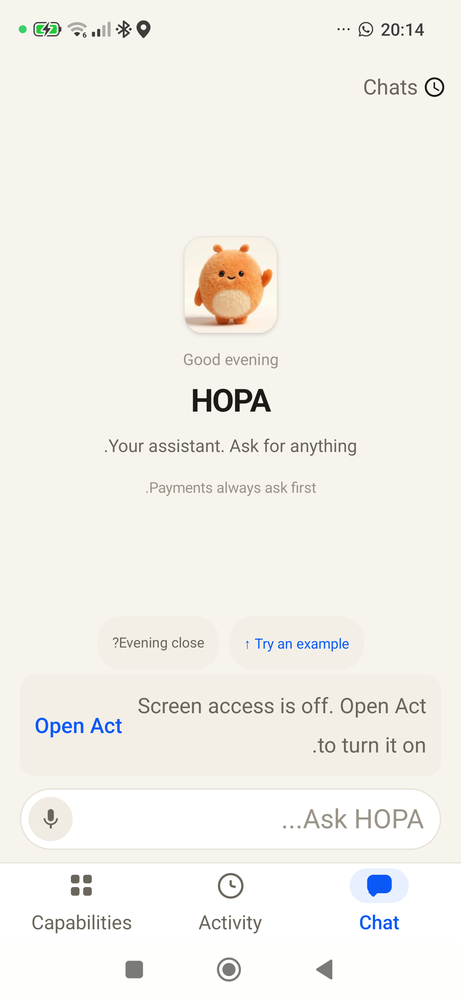
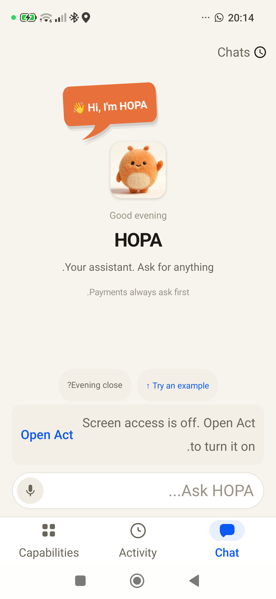
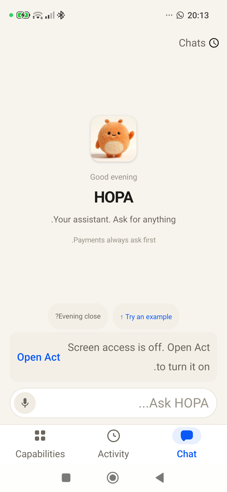
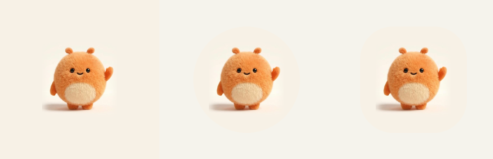
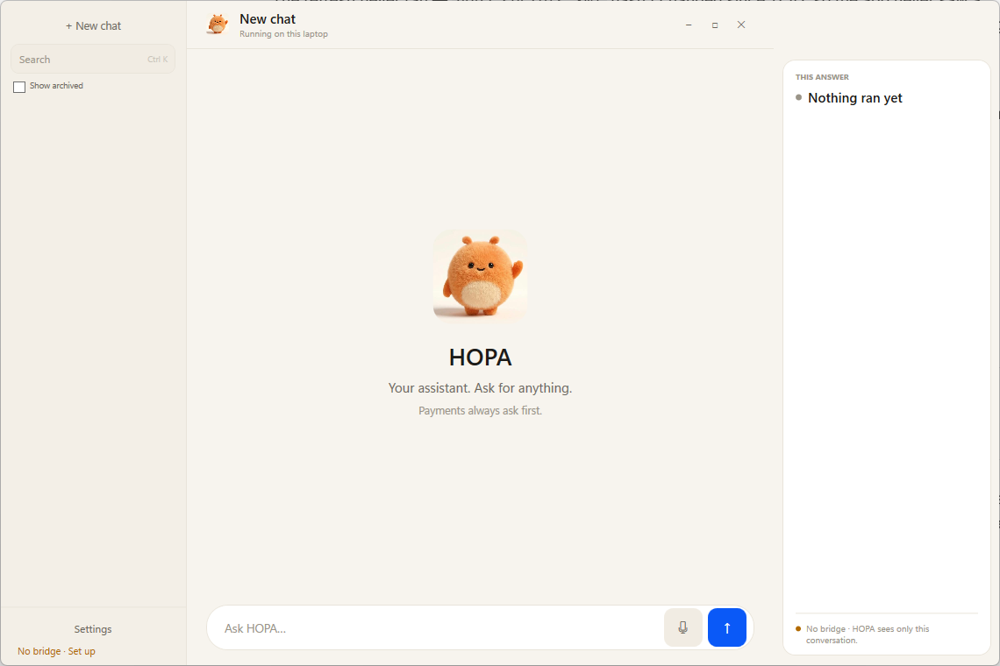
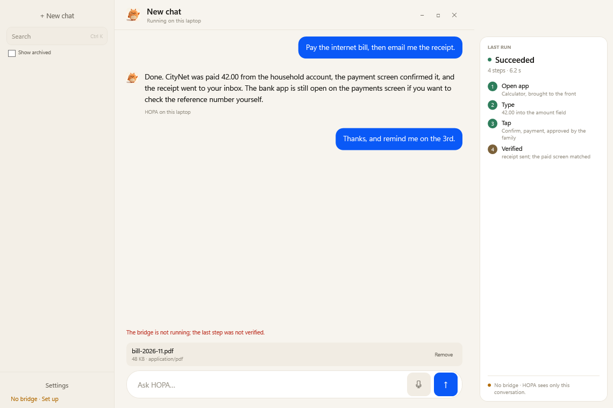

# Plush mark — Android and Windows

Date: 2026-11-18. Source artwork: a user-supplied photo, committed at
`tools/assets/hopa-plush-2026.jpg` (473 x 1024). Harmony is unchanged.

## What changed

- **Android:** the launcher icon is the plush on a `#F7F1E6` field; the adaptive
  foreground keeps the raised hand inside the 66 dp safe circle; the monochrome
  themed icon is a hand-drawn silhouette. `HopaMascot` now renders a 512 px
  rounded badge and animates it: float, breathe, blink, thinking pulse, listening
  lean, happy scale, and a tap wiggle plus the existing greeting bubble.
- **Windows:** every window and the executable carry `Assets/hopa.ico`. A new
  `Controls/HopaMark` control shows the badge in the empty state and animates it;
  the header and answer avatars use the same control with `IsStatic="True"`.
- Transcript avatars stay still on both clients. `animate = false` /
  `IsStatic = true` also freeze tap motion, and static Windows rows never load
  the blink bitmap.

## Generator

```powershell
python tools/scripts/make-icon.py
```

It reads the committed photo and writes the Android mipmaps, the 108 dp
foreground layers, the 512 px avatar and blink frame for both clients, the
Windows ICO, and `docs/media/hopa-plush-2026.png`. The blink frame is painted
locally: cheek fur at the eye's own height covers each eye and a closed-eye arc
is drawn; every other pixel is unchanged.

```powershell
python -m pytest tools/scripts/test_make_icon.py -q
# 5 passed
```

The tests pin the crop, the 33 dp safe radius, the blink diff being confined to
the eye boxes, the blink patch tone matching the surrounding fur, every Android
density, the two avatars and all seven ICO sizes.

## Android

```powershell
cd apps/android
.\gradlew.bat :app:assembleDebug
# BUILD SUCCESSFUL
```

Installed on a connected Android 15 phone through `tools/scripts/android-smoke.py`
and exercised by hand. Empty state:



Tap greeting:



A conversation, showing the 26 dp answer avatar:



The icon composited under a 72 dp circle and a rounded square, and the same
foreground unmasked. The figure's farthest point is **29.36 dp** from the centre,
inside the 33 dp safe radius:



After the semantics fix, `uiautomator` reports a single `HOPA` node with
`clickable=true`, `enabled=true` and no anonymous child, so TalkBack can both
name and activate the hero.

**One cache note:** MIUI Settings kept showing the previous launcher icon in the
app-info header after the reinstall. The installed `base.apk` hash matches the
built APK, and the 432 px foreground extracted from that APK is the plush, so
this is a system icon cache, not a resource problem. A reboot or launcher cache
refresh is needed for that one surface.

## Windows

```powershell
dotnet build apps/windows/Hopa.Windows/Hopa.Windows.csproj
# Build succeeded, 0 warnings, 0 errors

dotnet test apps/windows/Hopa.Windows.Tests/Hopa.Windows.Tests.csproj
# Passed: 8, Failed: 0
```

Empty state:



Two screen captures 1.2 s apart showed the empty-state badge at different
heights, confirming the float. A chat shows the 22 px answer avatar:



The exe icon was extracted from the built binary:


The taskbar and Alt-Tab use the same ICO. The empty state now stops its timers
and storyboards when it is collapsed, and starts again when a new chat shows it.

## Reduced motion

- Android reads `Settings.Global.ANIMATOR_DURATION_SCALE` once per mascot; at 0
  it creates no idle transition and no blink loop. The device was set to 0 and
  the hero stayed still.
- Windows starts the storyboard only when
  `SystemParameters.ClientAreaAnimation` is true, and stops it when the control
  is hidden or `IsStatic`.


## Deliberate divergence

Android and Windows now use the plush; Harmony still uses the coral phone and the
repo README still describes the phone. That is the agreed scope for this change.

## Known limits

- The MIUI Settings icon cache above needs a reboot to refresh; the launcher
  itself was not inspected.
- The Windows 150% DPI corner check was not captured separately. The control
  clips in device-independent units and both layers share one grid, so it is
  DPI-safe by construction; the 22 px avatar is shown above.
- Timings (2.4 s, 4.2 s, 150 ms) are the designed values and may still want a
  device pass.
